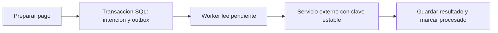

# Masterclass Integraciones y tareas en segundo plano

**Cuándo:** antes de empezar Àmbit, sin fecha fija. **Duración: 90 minutos.** [Quiz](masterclass-integrations-quiz.md): 12 preguntas en 15 minutos al día siguiente, fuera de clase.

**Nota sobre los ejemplos:** las menciones a Àmbit y Holded son orientativas. No describen una integración aprobada. Los pagos, referencias y datos de CourtConnect son ficticios.

## Preparación

Driss trae el diseño de pago y caducidad de la [Parte III](../../reto/Parte3/Ejercicio2/README.md). La sesión no exige integrar una pasarela real ni añadir requisitos al reto. Yamel prepara tarjetas con «aceptado», «respuesta perdida», «reinicio» y «dos workers». Los ejemplos son fragmentos independientes de lectura.

La referencia de C# es .NET 10. La versión concreta del paquete `Microsoft.Extensions.Http.Resilience` que se instalaría queda **por verificar** junto con el proyecto consumidor; no se instala ni se cobra nada en esta clase.

Vocabulario previo visible: `DbContext` es una sesión de EF Core para consultar y guardar datos; hosted service es un servicio cuyo arranque y parada gestiona la aplicación; Job es una ejecución finita que arranca, trabaja y termina. Se recuperan en las diapositivas 8 y 9, no son nuevos patrones a implementar.

## Agenda

| Bloque | Minutos | Diapositivas |
| --- | --- | --- |
| El problema de la respuesta perdida | 5 | 1 |
| Clientes HTTP y conexiones | 15 | 2 a 3 |
| Resiliencia y límites del reintento | 15 | 4 a 5 |
| Idempotencia y outbox | 15 | 6 a 7 |
| Worker, scope y reloj | 10 | 8 a 9 |
| Traslado a facturas de Holded | 5 | 10 |
| Taller en papel | 20 | 11 |
| Cierre | 5 | 12 |
| **Total** | **90** | |

### Diapositiva 01. No recibir respuesta no significa no haber pagado

**Puntos clave:**

- Una llamada HTTP puede fallar antes, durante o después de que el proveedor actúe.
- **Timeout:** límite de espera; no demuestra que la operación remota se haya cancelado.
- Separar intención de pago, envío y resultado confirmado.

**Notas del ponente:**

**Qué decir:** «El proveedor cobra y responde. La red pierde la respuesta. Nosotros vemos un error. ¿Qué pasaría si creamos otro pago sin preguntar nada?».

**Contexto para Yamel:** Dibujar cliente, red y proveedor. Un proceso externo no participa automáticamente en la transacción SQL local. La incertidumbre es un estado que debe representarse, no traducirse a «falló, vuelve a pagar». El ejercicio usa una simulación; esta clase enseña el contrato necesario para pensar en una integración real.

### Diapositiva 02. Typed HttpClient: un cliente con una tarea

**Puntos clave:**

- **Typed client:** clase que agrupa las llamadas a un servicio concreto.
- **IHttpClientFactory:** crea clientes y cachea y rota **handlers**, las piezas que envían HTTP; cada handler gestiona un **pool**, un conjunto de conexiones reutilizables.
- El resto de la aplicación pide una operación, no construye URLs ni conoce cabeceras del proveedor.

Ejemplo aislado: un proveedor ficticio devuelve el estado como texto. No representa el contrato de una pasarela real.

```csharp
public sealed class TournamentPaymentClient(HttpClient httpClient)
{
    public Task<string> GetStatusAsync(
        Guid paymentId,
        CancellationToken cancellationToken) =>
        httpClient.GetStringAsync(
            $"payments/{paymentId}/status", cancellationToken);
}
```

**Notas del ponente:**

**Qué decir:** «La clase sabe cómo hablar con pagos. Tu caso de uso no debería repetir la dirección ni el detalle de la petición cada vez».

**Contexto para Yamel:** En una implementación, el adaptador pertenece a Infrastructure y puede cumplir un contrato de Application. Separar errores HTTP de estados de negocio. `CancellationToken` permite propagar la cancelación, no deshacer un cobro remoto. Configurar dirección, autenticación y observabilidad fuera de cada método. [Clientes tipados y factory](https://learn.microsoft.com/dotnet/core/extensions/httpclient-factory).

### Diapositiva 03. Reutilizar conexiones, no estado de una petición

**Puntos clave:**

- Reutilizamos conexiones, no estado de una petición.
- Crear y destruir `new HttpClient()` por llamada puede agotar conexiones.
- La factory puede entregar nuevos clientes reutilizando sus handlers, las piezas que envían HTTP.
- `HandlerLifetime` vale dos minutos por defecto; no ordena cerrar cada conexión exactamente a los dos minutos.
- Un cliente tipado no debe quedar cautivo en un singleton.

**Notas del ponente:**

**Qué decir:** «Crear otro objeto cliente no obliga a abrir todo desde cero si lo gestiona la factory: reutilizamos conexiones, no estado de una petición».

**Contexto para Yamel:** Alternativa válida: cliente duradero con `SocketsHttpHandler.PooledConnectionLifetime` correctamente configurado. Evitar la afirmación absoluta de que solo existe la factory. En un `BackgroundService`, resolver el cliente tipado a través de un servicio scoped, o pedir un cliente nombrado a la factory. No mutar cabeceras compartidas con tokens de distintos usuarios. La reutilización de handlers exige cuidado con cookies y estado por petición. [Guía de HttpClient](https://learn.microsoft.com/dotnet/fundamentals/networking/http/httpclient-guidelines).

### Diapositiva 04. Retry, timeout y circuit breaker

**Puntos clave:**

- **Retry:** repetir un intento después de un fallo transitorio.
- Esperar progresivamente con variación evita repetir todos a la vez; los nombres de estas técnicas quedan en el glosario.
- **Circuit breaker:** dejar de llamar temporalmente a un servicio que falla repetidamente.
- Un timeout por intento y uno total limitan tiempos distintos.

Configuración ilustrativa con `Microsoft.Extensions.Http.Resilience`; el dominio `.invalid` no es un servicio real.

```csharp
using Microsoft.Extensions.Http.Resilience;

builder.Services.AddHttpClient<TournamentPaymentClient>(client =>
{
    client.BaseAddress = new Uri("https://payments.example.invalid/");
})
.AddStandardResilienceHandler(options =>
{
    options.Retry.DisableForUnsafeHttpMethods();
});
```

**Notas del ponente:**

**Qué decir:** «Repetir puede ayudar si hubo un corte breve. Si el proveedor está caído, insistir sin pausa empeora las cosas. El circuito abierto nos obliga a esperar o informar, no inventa una respuesta».

**Contexto para Yamel:** Valores por defecto a fecha 31/10/2026; comprobar al instalar: limitador de concurrencia (1.000 permisos, cola 0), timeout total 30 s, 3 reintentos con espera exponencial inicial de 2 s y variación, circuito (10 % de fallos, mínimo 100 operaciones en 30 s, apertura 5 s) y timeout por intento 10 s, de fuera hacia dentro. No son valores recomendados sin medir. Aquí `DisableForUnsafeHttpMethods` desactiva retries de POST, PUT, PATCH, DELETE y CONNECT, pero GET sigue pudiendo reintentarse ante fallos transitorios. Un método no seguro no equivale siempre a no idempotente. `Retry.ShouldRetryAfterHeader` vale `true` por defecto y usa `Retry-After` para calcular la espera; respetar además cancelación y presupuesto total. No apilar handlers ni retries en cada capa. Fuentes: [Build resilient HTTP apps](https://learn.microsoft.com/en-us/dotnet/core/resilience/http-resilience) y [ShouldRetryAfterHeader](https://learn.microsoft.com/en-us/dotnet/api/microsoft.extensions.http.resilience.httpretrystrategyoptions.shouldretryafterheader).

### Diapositiva 05. Cuándo no reintentar a ciegas

**Puntos clave:**

| Situación | Qué estudiar antes de repetir |
| --- | --- |
| Consulta de estado falla temporalmente | Reintento limitado y espera |
| Datos inválidos o permiso denegado | Corregir datos o autorización; repetir igual no ayuda |
| Proveedor limita peticiones | Respetar su contrato y tiempo de espera |
| Envío de pago sin respuesta | Consultar estado o repetir con una clave reconocida por el proveedor |
| Proveedor sin deduplicación ni consulta fiable | Parar el reenvío automático y conciliar |

**Conciliar** es contrastar el estado local con el externo para resolver una incertidumbre. **Deduplicar** es reconocer un intento repetido y evitar otro efecto.

**Notas del ponente:**

**Qué decir:** «Primero pregunta si repetir puede cambiar el resultado dos veces. Un error no es una orden universal de volver a enviar».

**Contexto para Yamel:** No deducir de un 500 que no hubo efecto. Un breaker limita presión; no deduplica ni guarda mensajes pendientes. No usar peticiones paralelas especulativas para pagos sin un contrato que lo permita. Registrar referencia, resultado y duración, no credenciales ni datos de tarjetas.

### Diapositiva 06. Idempotency: una intención, un efecto

**Puntos clave:**

- **Idempotency:** repetir la misma operación no duplica su efecto de negocio.
- **Idempotency key:** identificador estable de esa intención, no uno nuevo por reintento.
- Guardar clave, operación, importe, moneda y resultado de forma duradera.
- Misma clave con distinto contenido debe rechazarse, no reutilizarse silenciosamente.

| Intento ficticio | Clave | Resultado esperado del contrato |
| --- | --- | --- |
| Pagar inscripción al torneo | `payment-demo-42` | Un pago de 10 EUR |
| Repetir tras perder respuesta | `payment-demo-42` | El mismo resultado, no otro cobro |
| Cambiar importe conservando clave | `payment-demo-42` | Conflicto, revisión del cliente |

**Notas del ponente:**

**Qué decir:** «La clave nombra el pago, no la llamada de red. Si generas otra al reintentar, le estás pidiendo al proveedor otra operación».

**Contexto para Yamel:** Persistir antes de enviar y aplicar unicidad y coordinación atómica frente a dos peticiones simultáneas. Un `if` que busca y luego inserta puede tener una carrera. La clave local no protege al proveedor si este la ignora. Su formato de transporte, ámbito, retención y respuesta al duplicado dependen del contrato. No atribuir una cabecera `Idempotency-Key` a Holded sin comprobarla. Retener datos mínimos suficientes para conciliar; no borrar la prueba de un pago mientras pueda repetirse.

La propuesta de cabecera [Idempotency-Key de IETF](https://datatracker.ietf.org/doc/draft-ietf-httpapi-idempotency-key-header/) sigue siendo un Internet-Draft, no un RFC publicado. El contrato del proveedor determina qué acepta y qué efecto tiene repetirla.

### Diapositiva 07. Transactional outbox

**Puntos clave:**

- **Outbox:** tabla de mensajes pendientes de enviar.
- Guardar cambio de negocio y mensaje en la misma transacción de base de datos.
- **Transacción:** cambios que se confirman juntos o se revierten; no incluye automáticamente al proveedor HTTP.
- Un **worker**, proceso que trabaja sin petición de usuario, lee pendientes y envía fuera de esa transacción.
- Puede enviarse más de una vez; el receptor debe deduplicar. El nombre de esta garantía queda en el glosario.



**Notas del ponente:**

**Qué decir:** «Guardamos el encargo junto con el cambio. Si reiniciamos antes de enviarlo, el encargo sigue ahí. Pero si reiniciamos después del cobro y antes de marcarlo, volveremos a verlo pendiente».

**Contexto para Yamel:** Outbox resuelve la escritura dual local, no garantiza un efecto externo exactamente una vez. En EF Core, una sola confirmación transaccional puede guardar ambas filas; dos bases o dos `SaveChanges` independientes no forman automáticamente una transacción. No mantener una transacción SQL abierta durante una llamada lenta. Para varios workers, reclamar mensajes con control de concurrencia y una concesión temporal recuperable; deduplicar sigue siendo necesario. Prever orden si importa, reintentos limitados, mensajes bloqueados y revisión manual. [Mención oficial del patrón outbox](https://learn.microsoft.com/dotnet/architecture/microservices/architect-microservice-container-applications/asynchronous-message-based-communication). El patrón también sirve sin microservicios.

### Diapositiva 08. BackgroundService y scope por unidad de trabajo

**Puntos clave:**

- **Hosted service:** servicio cuyo arranque y parada gestiona la aplicación; `BackgroundService` es una base .NET para escribirlo.
- **DbContext:** sesión de EF Core para consultar y guardar datos.
- **Scope:** periodo en el que se comparten y liberan servicios como ese contexto.
- Crear y cerrar un scope por mensaje o lote acotado.
- **CancellationToken:** señal para detener trabajo de forma cooperativa.

`OutboxWorker` ilustra el tipo de servicio que viviría en el host `CourtConnect.Worker`, no en la API; no se exige añadir outbox al reto. El fragmento va dentro de una clase con constructor primario `OutboxWorker(IServiceScopeFactory scopeFactory, TimeProvider timeProvider) : BackgroundService`. Sus parámetros no se reasignan. Requiere `using Microsoft.Extensions.DependencyInjection;`. `IOutboxDispatcher` es un contrato didáctico para procesar una unidad, no una API de .NET ni su implementación. El reloj se explica en la siguiente diapositiva.

```csharp
protected override async Task ExecuteAsync(CancellationToken stoppingToken)
{
    while (!stoppingToken.IsCancellationRequested)
    {
        await using (AsyncServiceScope scope = scopeFactory.CreateAsyncScope())
        {
            IOutboxDispatcher dispatcher = scope.ServiceProvider
                .GetRequiredService<IOutboxDispatcher>();
            await dispatcher.DispatchOneAsync(stoppingToken);
        }

        await Task.Delay(TimeSpan.FromSeconds(5), timeProvider, stoppingToken);
    }
}
```

**Notas del ponente:**

**Qué decir:** «Cada encargo recibe sus herramientas. Al terminar las devolvemos, incluso si hay un error. No dejamos el contexto abierto mientras esperamos el siguiente turno».

**Contexto para Yamel:** Fragmento de lifetime, no un worker listo para producción. El dispatcher deberá clasificar fallos y persistir el próximo intento; un fallo inesperado requiere registro y política explícita del host, no un catch que oculte todo. La cancelación de parada no debe disparar más reintentos. Un scope no es una transacción ni un bloqueo entre workers. No compartir `DbContext` en paralelo. [Servicios scoped en BackgroundService](https://learn.microsoft.com/dotnet/core/extensions/scoped-service).

### Diapositiva 09. TimeProvider y pruebas de fallos

**Puntos clave:**

- **TimeProvider:** reloj que se puede sustituir en pruebas.
- Usarlo para decidir cuándo vence algo y cuándo se puede reintentar.
- No esperar minutos reales para comprobar una caducidad.
- Probar respuesta perdida, reinicio y dos workers, además del caso correcto.
- Un **Job** es una tarea que arranca, acaba y sale. Se estudia como alternativa; el reto despliega su worker continuo con mínimo y máximo de una réplica.
- Un temporizador interno no despierta una app a cero. Para otras cargas conviene valorar activación por eventos o una réplica mínima.

**Notas del ponente:**

**Qué decir:** «Una prueba debe poder avanzar el reloj. Pero cambiar el reloj no simula que el proceso se apague: necesitamos probar también qué queda guardado».

**Contexto para Yamel:** `FakeTimeProvider` ayuda a controlar el tiempo; comprobar versión del paquete de pruebas antes de instalar. Separar pruebas del reloj, persistencia real y un servidor HTTP simulado. Verificar efectos externos, no solo llamadas o un estado final verde. Los cinco segundos son ilustrativos, no una cadencia recomendada. Para outbox continuo conviene valorar mínimo positivo o activación por eventos según su carga. No se adapta el worker del reto a Job. La [documentación oficial de Jobs](https://learn.microsoft.com/en-us/azure/container-apps/jobs#long-running-jobs) advierte de interrupciones por mantenimiento en ejecuciones largas, recomienda `replicaRetryLimit` de al menos 1 y diseñar para procesamiento al menos una vez: una repetición debe ser segura. No es una promesa de ejecución exactamente una vez. [TimeProvider](https://learn.microsoft.com/dotnet/standard/datetime/timeprovider-overview) y [sesión cloud](masterclass-cloud-azure.md).

### Diapositiva 10. De pagos a facturas de Holded

**Puntos clave:**

- El adaptador traduce el documento local al contrato de la API externa.
- Mantener una referencia local estable y el identificador que devuelva el proveedor.
- Si se pierde la respuesta, resolver la incertidumbre antes de crear otra factura.
- Enviar una factura no es lo mismo que cobrar un pago.

**Notas del ponente:**

**Qué decir:** «La misma pregunta aparece con una factura: ¿ya existe allí o no? No queremos que un corte de red cree dos documentos. Necesitamos conocer qué permite el proveedor para reconocerlos».

**Contexto para Yamel:** Revisar en la [documentación oficial de Holded](https://developers.holded.com/) autenticación, permisos, creación y consulta de documentos, referencias externas, estados, impuestos, errores, límites y deduplicación. Endpoint exacto, versión, cuotas, precios, entorno de pruebas y soporte de claves de idempotencia: **por verificar**. Si no hay creación idempotente ni búsqueda inequívoca, documentar conciliación y una parada manual ante resultados desconocidos; outbox por sí solo no evita duplicados. Gestionar secretos según la [masterclass cloud](masterclass-cloud-azure.md), nunca en el documento ni en logs.

### Diapositiva 11. Taller: un torneo, un pago

**Puntos clave:**

- Diseñar el envío de un pago ficticio de 10 EUR.
- El proveedor de prueba reconoce una clave estable y permite consultar su estado.
- Introducir fallos sin cambiar la intención del usuario.
- Entregar un diseño, no código de una pasarela real.

**Notas del ponente:**

**Qué decir:** «Yo haré de proveedor. Puedo aceptar el pago y perder la respuesta. Enseña qué conservas y cómo continúas después de reiniciar sin crear un segundo cobro».

**Contexto para Yamel:** Taller de 20 minutos: dibujar estados y datos 5, introducir fallos 8, diseñar pruebas 4 y explicar 3. Tarjetas: fallo antes de enviar; aceptado con respuesta perdida; reinicio tras aceptación; dos workers sobre el mismo mensaje; misma clave con otro importe. En una segunda vuelta, retirar la garantía de deduplicación del proveedor y pedir una estrategia de parada y conciliación. No aceptar «retry tres veces» como diseño completo.

**Entrega y aceptación:** diagrama con intención, outbox, proveedor y confirmación; identidad estable del pago; atomicidad local; recuperación de mensajes reclamados; errores transitorios y definitivos separados. Pruebas que demuestran un solo efecto para duplicados válidos, rechazo de clave con contenido distinto y recuperación tras reinicio. Debe señalarse qué garantía depende del proveedor.

### Diapositiva 12. Cierre: qué promete cada pieza

**Puntos clave:**

- Factory gestiona transporte; resiliencia controla intentos y espera.
- Idempotencia protege el efecto repetido; outbox conserva encargos.
- Worker ejecuta; scope limita lifetimes; reloj permite probar el tiempo.
- Ninguna pieza sustituye el contrato externo ni la revisión humana.

**Notas del ponente:**

**Qué decir:** «Dime qué problema resuelve cada pieza y uno que no resuelve. Después enseña dónde dejarías el pago si no puedes saber todavía qué ocurrió».

**Contexto para Yamel:** Cierre de 5 minutos. Hacer el quiz al día siguiente, fuera de clase. No añadir la integración al alcance obligatorio de CourtConnect. Una futura decisión de implementación debe incluir contrato, pruebas, alertas, conciliación y responsable operativo.

## Apéndice opcional: gRPC frente a REST

Lectura autónoma, fuera de los 90 minutos; no es requisito del taller ni del quiz.

| Término | Qué es | Cuándo estudiarlo |
| --- | --- | --- |
| REST | Estilo de API orientado a recursos y semántica HTTP; suele usar JSON | Integraciones web públicas y contratos sencillos de inspeccionar |
| gRPC | Llamadas con contrato `.proto`, generación de clientes y mensajes binarios Protobuf | Comunicación controlada entre servicios y necesidades de streaming |
| Streaming | Enviar una secuencia de mensajes sin una respuesta única | Actualizaciones continuas |

**Qué decir:** «Son maneras de acordar cómo hablan dos programas. Ninguna elimina los cortes ni impide cobrar dos veces».

**Contexto para Yamel:** No decidir por una promesa genérica de velocidad. Revisar interoperabilidad, navegación web, HTTP/2, herramientas y compatibilidad de contratos. gRPC-Web añade condiciones específicas en navegador. La elección del protocolo no elimina idempotencia ni autorización. [Comparación oficial gRPC y HTTP APIs](https://learn.microsoft.com/aspnet/core/grpc/comparison?view=aspnetcore-10.0).

## Glosario

**Imprescindibles (15):** typed client, HttpClientFactory, handler, retry, timeout, circuit breaker, idempotencia, clave de idempotencia, conciliación, outbox, transacción, worker, scope, TimeProvider y CancellationToken.

**Que te suene:** los demás términos de consulta. REST y gRPC quedan fuera del taller y del quiz.

| Término | Explicación sencilla | Ejemplo |
| --- | --- | --- |
| Typed client / factory | Clase de un servicio / creador que gestiona transporte | Consultar el estado del pago |
| Handler / connection pool | Pieza de envío / conexiones reutilizables | Evitar abrir transporte desde cero |
| Retry / backoff / jitter | Repetir / esperar más / variar la espera | Consultar después de un corte breve |
| Timeout / circuit breaker | Límite de espera / pausa ante fallos repetidos | No bloquear indefinidamente el sistema |
| Idempotency / key | No duplicar efecto / identidad estable de operación | Un pago pese a dos intentos |
| Reconciliation | Contrastar estados para resolver dudas | Averiguar si el proveedor aceptó el pago |
| Outbox / transaction | Mensajes pendientes / cambios confirmados juntos | Intención y mensaje en SQL |
| At-least-once | Puede haber varios envíos del mismo mensaje | Reenviar después de un reinicio |
| Worker / BackgroundService | Proceso sin petición / base .NET para ejecutarlo | Procesar un pendiente |
| Scope / lifetime | Periodo compartido / duración del servicio | Contexto por unidad de trabajo |
| Singleton | Una instancia por contenedor de dependencias | El servicio alojado no conserva un DbContext para siempre |
| Hosted service / DbContext / Job | Servicio gestionado por el host / sesión de datos EF Core / tarea finita | Worker continuo frente a ejecución que termina |
| TimeProvider | Reloj sustituible | Avanzar una prueba sin esperar |
| CancellationToken | Señal cooperativa de cancelación | Parar el worker sin nuevos reintentos |
| REST / gRPC / Protobuf | API de recursos / llamadas tipadas / formato binario | Protocolos a comparar según el contrato |
