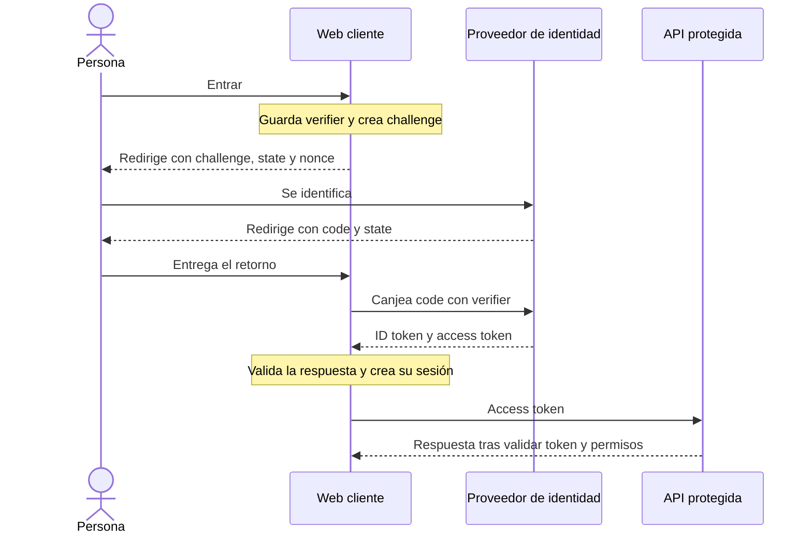

# Masterclass 0: Seguridad e identidad

**Cuándo:** al terminar el reto, antes de empezar Àmbit Escola. Sin fecha fija. **Dos sesiones de 90 minutos.** [Quiz](masterclass-security-quiz.md): 12 preguntas por sesión, 15 minutos al día siguiente, fuera de clase.

**Nota sobre los ejemplos:** los escenarios de Àmbit son orientativos, no decisiones aprobadas ni una descripción de sus procesos. Todos los ejemplos y datos son ficticios.

## Preparación

Driss repasa [Seguridad en 15 minutos](../court-connect/seguridad-en-15-minutos.md), su [ejercicio de identidad](../../reto/Parte2/Ejercicio2/README.md) y su revisión del [PR trampa](../../reto/Parte3/Ejercicio5/README.md). Trae una duda sobre permisos y otra sobre sesiones. No se revelan aquí los defectos del PR del reto.

Yamel prepara una pizarra y el ejemplo aislado del taller. No hacen falta cuentas cloud ni datos reales. Los fragmentos C# son de lectura, no una solución del ejercicio. La documentación de referencia usa .NET 10; la versión concreta del proyecto real queda por verificar antes de implementarlo.

## Sesión 1: Fundamentos y revisión de seguridad

### Agenda de la sesión 1

| Bloque | Minutos | Diapositivas |
| --- | --- | --- |
| Identidad, permisos y sesión | 10 | 1 a 2 |
| JWT, claims y políticas | 15 | 3 a 4 |
| Contraseñas | 5 | 5 |
| OWASP y defensas | 20 | 6 a 8 |
| Taller de revisión en papel | 30 | 9 |
| Puesta en común y cierre | 10 | 10 |
| **Total** | **90** | |

### Diapositiva 01. Entrar no permite hacerlo todo

**Puntos clave:**

- **Authentication**, autenticación: comprobar quién hace la petición.
- **Authorization**, autorización: decidir si puede hacer esa acción sobre ese dato.
- Una **API** ofrece operaciones a otros programas; un **endpoint** es una entrada concreta.
- En una API: 401 indica falta de autenticación válida; 403, permiso insuficiente.

**Notas del ponente:**

**Qué decir:** «Tu cuenta identifica quién eres. No te convierte en dueño de todos los partidos. Cambiar un identificador en una dirección no debería abrirte los datos de otro jugador».

**Contexto para Yamel:** Conectar con R7 y R8 sin reconstruir su solución. La identidad procede de un mecanismo validado, no de `userId` en un formulario. La política sobre 403 o 404 para ocultar la existencia de recursos debe ser coherente y probada. Un control en la pantalla mejora la experiencia, pero el servidor conserva la responsabilidad.

### Diapositiva 02. Cookie y bearer token

**Puntos clave:**

- **Cookie:** dato que el navegador guarda y envía según sus reglas.
- **Access token:** credencial que un cliente presenta para acceder a una API.
- **Bearer token:** quien lo posee puede usarlo mientras sea válido; se envía en `Authorization: Bearer <token>`.
- **Refresh token:** credencial sensible para renovar el acceso cuando procede.
- CourtConnect combina cookie entre navegador y web, y token entre web y API.

Protecciones de cookie: `HttpOnly` impide leerla desde JavaScript; `Secure` exige HTTPS; `SameSite` limita ciertos envíos entre sitios. No sustituyen los permisos ni antiforgery.

**Notas del ponente:**

**Qué decir:** «Piensa en una acreditación temporal. No envías tu contraseña en cada llamada. Pero si alguien copia la acreditación, puede intentar usarla. Cookie y token no son dos formatos que deban competir».

**Contexto para Yamel:** HTTPS protege el transporte. `HttpOnly` impide leer una cookie desde JavaScript; `Secure` restringe su envío a HTTPS; `SameSite` limita ciertos envíos entre sitios. No sustituyen autorización ni protección CSRF. **Refresh token** es una credencial para renovar el acceso: también es sensible. Cerrar la sesión web no garantiza revocar inmediatamente todos los bearer tokens emitidos. Evitar tokens en URLs, logs o herramientas externas.

### Diapositiva 03. JWT: leer no es validar

**Puntos clave:**

- **JWT, JSON Web Token:** formato estándar para transportar afirmaciones sobre una identidad.
- Un JWT firmado tiene cabecera, datos y firma; los nombres ingleses están en el glosario.
- La firma detecta cambios; no cifra el contenido. No incluir contraseñas, salud ni otros secretos.
- Pasada su caducidad, se rechaza.
- **MapIdentityApi:** registra endpoints de cuenta de ASP.NET Core Identity. Su token integrado no es JWT: es **opaco**, el cliente lo presenta sin interpretar sus datos.

**Notas del ponente:**

**Qué decir:** «Una firma es un sello de integridad, no un sobre cerrado. Poder leer el nombre del usuario no demuestra que el token sea auténtico. Y que una cadena viaje como bearer no la convierte en JWT».

**Contexto para Yamel:** Dibujar `header.payload.signature` sin un token real. `MapIdentityApi`, usado con los servicios de Identity, ofrece cookies o tokens de formato propio protegido por ASP.NET Core. El cliente trata estos últimos como opacos; no debe pasarlos a un validador JWT. Un JWT firmado usual es legible; existen formatos cifrados, pero no se presupone cifrado. Usar bibliotecas de autenticación, no implementar firmas. [Identity API y tokens](https://learn.microsoft.com/aspnet/core/security/authentication/identity-api-authorization?view=aspnetcore-10.0).

### Diapositiva 04. Claims, roles y policies

**Puntos clave:**

- **Claim:** dato de una identidad validada, como el identificador de cuenta.
- **Role:** categoría, como `Player` u `Organizer`; ASP.NET Core la representa mediante claims de rol.
- **Policy:** conjunto de condiciones de acceso, como exigir autenticación y un rol.
- El rol indica una función, no quién es dueño de cada recurso.

**Notas del ponente:**

**Qué decir:** «La acreditación dice quién eres y cuál es tu función. La policy dice qué debes cumplir para pasar. Aun siendo organizador, falta preguntar de qué partido hablamos».

**Contexto para Yamel:** `AddAuthorization` registra políticas; `RequireAuthorization` o `[Authorize]` las aplican. `IAuthorizationService` permite evaluar condiciones con un recurso cargado. No aceptar claims elegidos por el cliente ni asignar roles privilegiados desde el registro público. Enseñar las [políticas de ASP.NET Core](https://learn.microsoft.com/aspnet/core/security/authorization/policies?view=aspnetcore-10.0), sin resolver los endpoints abiertos del curso.

### Diapositiva 05. Password hash y salt

**Puntos clave:**

- **Hash de contraseña:** resultado de una función diseñada para verificarla sin guardar el texto original.
- **Salt:** valor aleatorio distinto por contraseña guardada; evita resultados iguales para contraseñas iguales.
- La verificación usa una función deliberadamente costosa. No basta con aplicar SHA-256 directamente.
- Identity gestiona el formato, la verificación y la actualización del hash.

**Notas del ponente:**

**Qué decir:** «No necesitamos recuperar la contraseña. Necesitamos comprobar si la que llega es correcta. El salt no es una segunda contraseña: puede guardarse junto al hash».

**Contexto para Yamel:** Hash no es cifrado reversible. Un hash rápido facilita probar muchas contraseñas robadas. No inventar un algoritmo ni fijar aquí parámetros que pueden cambiar. Revisar la configuración soportada de `PasswordHasher` y la [guía OWASP de almacenamiento de contraseñas](https://cheatsheetseries.owasp.org/cheatsheets/Password_Storage_Cheat_Sheet.html). Límites de intentos, recuperación y MFA completan la defensa; los parámetros concretos quedan por verificar para la versión elegida.

### Diapositiva 06. OWASP Top 10 como mapa de riesgos

**Puntos clave:**

**OWASP Top 10** reúne familias de riesgos frecuentes. Usamos la edición **2025**, contrastada con su [lista oficial](https://top10.owasp.org/2025/). No es una certificación ni una lista suficiente para dar una aplicación por segura.

| Categoría oficial | Qué significa | Ejemplo de revisión en CourtConnect |
| --- | --- | --- |
| A01 Broken Access Control | Permisos incorrectos | Un jugador consulta una inscripción ajena |
| A02 Security Misconfiguration | Configuración insegura | Una credencial en `appsettings.json` versionado |
| A03 Software Supply Chain Failures | Fallos en dependencias y construcción | Paquete de origen no comprobado |
| A04 Cryptographic Failures | Protección criptográfica inadecuada | Contraseñas guardadas como texto |
| A05 Injection | Datos tratados como instrucciones | Concatenar una entrada dentro de SQL |
| A06 Insecure Design | Diseño sin controles necesarios | No limitar intentos de un código de acceso |
| A07 Authentication Failures | Identificación defectuosa | Aceptar una sesión caducada |
| A08 Software or Data Integrity Failures | Confiar sin verificar integridad | Aceptar una notificación de pago falsificada |
| A09 Security Logging and Alerting Failures | Registro y alertas inadecuados | No detectar denegaciones repetidas |
| A10 Mishandling of Exceptional Conditions | Fallos mal gestionados | Permitir acceso cuando falla la comprobación |

**IDOR:** acceso indebido a un objeto cambiando su identificador; un GUID no sustituye al permiso. **Log:** registro de actividad; no debe copiar secretos ni fichas personales.

**Notas del ponente:**

**Qué decir:** «No memorices diez números. Escoge un riesgo y dime qué dato protegerías, dónde pondrías el control y qué prueba demostraría que funciona».

**Contexto para Yamel:** Recorrer la tabla en pocos minutos y profundizar en las diapositivas siguientes. **IDOR, Insecure Direct Object Reference:** acceder a un objeto cambiando su identificador sin comprobar el permiso. Un GUID difícil de adivinar no lo soluciona. **Log:** registro de actividad; no volcar contraseñas, tokens, cuerpos completos, correos o diagnósticos médicos. Registrar resultado, acción y un identificador mínimo protegido. Si se publica un secreto, retirarlo del archivo no basta: revocarlo o rotarlo y revisar la exposición. El exceso de datos en logs también es un riesgo de privacidad, no algo que deba forzarse a una única categoría del Top 10.

### Diapositiva 07. SQL injection y consultas parametrizadas

**Puntos clave:**

- **SQL injection:** una entrada acaba cambiando las instrucciones enviadas a la base de datos.
- **Parameterization:** separar el texto de la consulta de sus valores.
- EF Core parametriza los valores de consultas LINQ traducidas a SQL.
- `FromSqlRaw` con texto concatenado puede reintroducir el fallo.

Fragmento de lectura: `db` es un contexto de ejemplo; `gameId` es un valor recibido.

```csharp
// La proyección crea un tipo anónimo; aquí es necesario usar var.
var games = await db.Games
    .Where(game => game.Id == gameId)
    .Select(game => new { game.Id, game.Title })
    .ToListAsync(cancellationToken);
```

**Notas del ponente:**

**Qué decir:** «El valor va en su casilla; no se pega a las instrucciones. EF Core ayuda a hacer eso. Pero usar EF Core no da automáticamente permiso para leer todos los partidos».

**Contexto para Yamel:** LINQ usa sintaxis de métodos. Este fragmento solo muestra parametrización y proyección: no es un endpoint autorizado. `FromSql` con interpolación preservada admite parámetros; convertir antes a `string` o concatenar SQL requiere especial revisión. Los nombres de tabla o columna no son valores parametrizables: escogerlos mediante listas permitidas. [Consultas SQL con EF Core](https://learn.microsoft.com/ef/core/querying/sql-queries).

### Diapositiva 08. CSRF y XSS en Blazor

**Puntos clave:**

- **CSRF, Cross-Site Request Forgery:** otro sitio provoca una acción usando la sesión que el navegador envía automáticamente.
- **Antiforgery token:** comprobación adicional para distinguir un envío legítimo de formulario.
- **XSS, Cross-Site Scripting:** contenido no fiable acaba ejecutándose como código en el navegador.
- Blazor codifica texto al mostrarlo; `MarkupString` y JavaScript pueden saltarse esa protección.

**Notas del ponente:**

**Qué decir:** «CSRF intenta usar tu sesión. XSS intenta ejecutar código en tu página. Son problemas distintos. Un formulario seguro no se consigue solo ocultando botones».

**Contexto para Yamel:** En .NET 10, los Minimal APIs que reciben formularios exigen validación antiforgery por defecto. Blazor necesita `app.UseAntiforgery()`, después de autenticación y autorización; registrar los servicios no añade ese middleware. Los formularios Static SSR pueden incorporar el token: comprobar también la validación del servidor. Los endpoints que reciben JSON y usan cookies necesitan revisión explícita; no heredan la protección del enlace de formularios. SameSite es defensa adicional, no sustituto. Nunca cambiar estado con GET. En Interactive Server, revisar autorización de operaciones y del recurso, no asumir una petición HTTP nueva por clic. No renderizar HTML ajeno sin saneamiento. `HttpOnly` reduce robo de cookies, pero un XSS puede actuar con la sesión. [Prevent Cross-Site Request Forgery (XSRF/CSRF) attacks in ASP.NET Core](https://learn.microsoft.com/aspnet/core/security/anti-request-forgery?view=aspnetcore-10.0) y [seguridad Blazor](https://learn.microsoft.com/aspnet/core/blazor/security/?view=aspnetcore-10.0). No trasladar a .NET 10 los valores predeterminados documentados para versiones posteriores.

### Diapositiva 09. Taller: un listado que revela demasiado

**Puntos clave:**

- Ejemplo deliberadamente defectuoso, solo para revisión en papel.
- Señalar cada defecto, el dato expuesto y una corrección.
- Reescribir el recorrido en pseudocódigo y proponer pruebas.

`TrainingDbContext` y sus entidades representan un modelo aislado del mentor. No ejecutar este endpoint en una aplicación publicada.

```csharp
app.MapGet("/training/games/{gameId}/contacts", async (
    Guid gameId,
    string userId,
    TrainingDbContext db,
    ILogger<Program> logger) =>
{
    List<string> contacts = await db.Registrations
        .Where(registration => registration.GameId == gameId)
        .Select(registration => registration.Player.Email)
        .ToListAsync();

    logger.LogInformation("Contacts for {UserId}: {Contacts}", userId, contacts);
    return Results.Ok(contacts);
});
```

**Notas del ponente:**

**Qué decir:** «No empieces por cambiar una línea. ¿Quién debería poder pedir esto? ¿Qué necesita recibir? ¿Qué datos acabarían también en los logs?».

**Contexto para Yamel:** Taller de 30 minutos: leer 5, marcar riesgos 8, corregir el flujo en papel 10 y diseñar pruebas 7. Acordar para el caso ficticio que solo el organizador del partido puede solicitar contactos y que debe justificarse cada campo. Guía de revisión: autenticación ausente; `userId` no fiable; falta comprobar rol y vínculo con el partido; exportación sin minimización; datos personales en logs. La consulta LINQ no presenta por sí misma inyección SQL. No premiar falsos positivos. No convertir la sesión en una solución completa del reto.

**Entrega y aceptación:** un recorrido corregido que obtiene la identidad validada, comprueba el recurso antes de devolver datos, limita campos y registra solo lo necesario. Tres pruebas: anónimo, organizador de otro partido y organizador autorizado. Esta última debe pasar; denegarlo todo no demuestra autorización correcta.

### Diapositiva 10. Cerrar con una prueba, no con una impresión

**Puntos clave:**

- Cada defecto necesita riesgo, corrección y comprobación.
- Una respuesta 200 no demuestra que el acceso fuera legítimo.
- Un hash no cifra; un JWT no autoriza por sí solo.

**Notas del ponente:**

**Qué decir:** «Explícame una corrección y una petición que ahora debe rechazarse. Después explica una que debe seguir funcionando».

**Contexto para Yamel:** Reservar los 10 minutos para comparar propuestas y dudas. Las preguntas 1 a 12 del quiz se hacen al día siguiente, fuera de clase. La siguiente sesión parte de estas distinciones, no exige memorizar atributos.

## Sesión 2: Identidad, permisos y privacidad en Àmbit

### Agenda de la sesión 2

| Bloque | Minutos | Diapositivas |
| --- | --- | --- |
| OAuth, OIDC y dibujo de PKCE | 15 | 11 a 12 |
| Personal y Entra ID | 10 | 13 |
| Familias: comparar alternativas | 10 | 14 |
| API, recursos y sociedades | 15 | 15 a 17 |
| Privacidad y secretos | 10 | 18 a 19 |
| Taller de flujos de entrada | 25 | 20 |
| Cierre | 5 | 21 |
| **Total** | **90** | |

### Diapositiva 11. OAuth 2.0 y OpenID Connect

**Puntos clave:**

- **OAuth 2.0:** permite a una aplicación obtener acceso autorizado a una API sin recibir la contraseña del usuario para ese servicio.
- **OpenID Connect, OIDC:** añade una forma estándar de saber quién ha iniciado sesión.
- **Proveedor de identidad:** servicio que identifica a la persona y comunica el resultado a la aplicación.
- **ID token:** resultado de identidad para el cliente. El access token ya visto se destina a la API.
- Actores del recorrido: persona, aplicación cliente, proveedor de identidad y API protegida. Los permisos solicitados se consultan como scope OAuth en el glosario.

**Notas del ponente:**

**Qué decir:** «No queremos que cada aplicación pida y guarde la contraseña del colegio. La persona se identifica ante su proveedor. La web recibe el resultado; la API recibe una credencial destinada a ella».

**Contexto para Yamel:** OAuth no es por sí solo un protocolo de login. **Scope** aquí significa permiso solicitado, no un scope del contenedor DI. Diferenciar permisos delegados, actuando por una persona, de permisos de aplicación sin usuario. No usar un ID token como access token de API. Usar bibliotecas soportadas para el protocolo. [OIDC en la plataforma de identidad](https://learn.microsoft.com/entra/identity-platform/v2-protocols-oidc).

### Diapositiva 12. Authorization code con PKCE

**Puntos clave:**

- **Authorization code:** código temporal que se intercambia por tokens.
- **PKCE:** prueba que vincula ese intercambio al cliente que inició el flujo.
- **Verifier:** valor aleatorio guardado por el cliente; **challenge:** su transformación enviada al inicio.
- El retorno debe ir a una dirección registrada. La biblioteca valida su relación con el inicio de sesión; `state` y `nonce` se definen en el glosario.



**Notas del ponente:**

**Qué decir:** «El código que vuelve por el navegador no basta para recoger los tokens. La web demuestra que conserva el valor con el que empezó. Seguimos las flechas, no escribimos el protocolo a mano».

**Contexto para Yamel:** `state` vincula la respuesta al flujo iniciado; `nonce` vincula el ID token a esa autenticación. Usar Code + PKCE también para SPA, aplicaciones ejecutadas en el navegador. PKCE debe usar `S256`; no sustituye HTTPS, validación del retorno ni autenticación de un cliente confidencial. La web de servidor canjea el código desde el servidor; un cliente público no puede custodiar un secreto. Según [RFC 9700, secciones 2.1.1, 2.1.2 y 2.4](https://www.rfc-editor.org/rfc/rfc9700.html#section-2.1.2), Implicit está desaconsejado (SHOULD NOT); el flujo de contraseña directa al cliente, ROPC, no debe usarse (MUST NOT). No igualar ambas expresiones normativas. Dejar el protocolo a bibliotecas soportadas. [Flujo oficial y PKCE](https://learn.microsoft.com/entra/identity-platform/v2-oauth2-auth-code-flow).

### Diapositiva 13. Entra ID para el personal

**Puntos clave:**

- **Tenant:** directorio de identidades de una organización.
- **App registration:** registro de una aplicación, sus retornos y permisos.
- **SSO, Single Sign-On:** reutilizar una sesión del proveedor entre aplicaciones permitidas.
- **MFA:** autenticación con más de un factor, no solo una contraseña.
- El rol de aplicación, asignado por administración, representa una función como coordinador.

**Notas del ponente:**

**Qué decir:** «Registrar la aplicación es presentarla al proveedor. Asignar un rol es decidir qué función tiene una persona. Ninguna de esas dos cosas decide automáticamente qué escuelas puede consultar».

**Contexto para Yamel:** Identificar directorio, administradores, altas, bajas y cuentas invitadas antes de configurar. Separar registro de la web y de la API cuando proceda; restringir emisores y retornos. App roles no son Azure RBAC, que gestiona acceso a recursos cloud. Estudiar **MFA**, un segundo factor de autenticación, y acceso condicional; licencias, disponibilidad y límites: **por verificar**. [Roles de aplicación](https://learn.microsoft.com/entra/identity-platform/howto-add-app-roles-in-apps).

### Diapositiva 14. Familias: email OTP sin elegir proveedor

**Puntos clave:**

- **Passwordless:** entrar sin una contraseña propia de la aplicación.
- **Email OTP, One-Time Passcode:** código temporal recibido por correo.
- **B2B:** colaboración con invitados de otras organizaciones; no equivale al directorio externo para clientes o familias.
- Controlar un correo no demuestra por sí solo relación legal con un menor.
- Comparar experiencia, soporte, coste y seguridad con una prueba pequeña.

| Aspecto | Entra External ID, external tenant | ASP.NET Core Identity |
| --- | --- | --- |
| Código por correo | Opción documentada de entrada con email OTP | Hay que diseñar e integrar el flujo; `MapIdentityApi` no lo añade por sí solo |
| Ventaja | Servicio gestionado y protocolos de identidad | Control de experiencia y del modelo local |
| Trabajo propio | Configuración, integración y permisos de negocio | Emisión, entrega, verificación, caducidad, uso único, abuso y recuperación |
| Coste a comparar | Usuarios activos mensuales, funciones contratadas y soporte | Desarrollo, mantenimiento, correo, alojamiento y operación |
| Importes y cuotas | **Por verificar** para fecha, región y contrato | **Por verificar** para proveedor de correo y carga |
| Prueba necesaria | Idioma, entrega, cuenta existente, reenvío, sesión y API | Lo anterior más intentos paralelos, reutilización y límites del flujo propio |

**Notas del ponente:**

**Qué decir:** «Sin contraseña no significa sin riesgo. Si alguien controla el buzón, puede recibir el código. Antes de decidir, probaremos la entrada y también qué pasa cuando el correo llega tarde o alguien pide muchos códigos».

**Contexto para Yamel:** La opción email OTP de external tenants está documentada; no confundirla con invitaciones B2B del directorio del personal. Cambiar el método configurado puede no migrar cuentas existentes: incluirlo en la prueba. En Identity, confirmar un correo o recuperar contraseña no equivale a ofrecer automáticamente login passwordless. No construir un servidor OAuth/JWT casero para salvar esta diferencia: si se exige JWT estándar, habrá que integrar un emisor soportado. Impedir enumeración de cuentas, limitar envío e intentos, resolver recuperación y revocación del vínculo familiar. [Métodos de External ID](https://learn.microsoft.com/entra/external-id/customers/concept-authentication-methods-customers) y [precios oficiales a consultar](https://azure.microsoft.com/pricing/details/microsoft-entra-external-id/). La comparación no selecciona una alternativa.

### Diapositiva 15. La API valida su access token

**Puntos clave:**

- **Issuer (`iss`):** emisor esperado y de confianza.
- **Audience (`aud`):** API destinataria esperada.
- **Firma:** integridad y autenticidad con las claves del emisor.
- **Expiration (`exp`):** no haber superado la caducidad; comprobar también el momento de validez.
- Después comprobar scopes, roles y permisos sobre el recurso.

**Notas del ponente:**

**Qué decir:** «Una acreditación auténtica para otro edificio no abre este. La API no confía en que la web diga que ya lo comprobó: valida lo que recibe».

**Contexto para Yamel:** Usar el middleware JWT bearer y bibliotecas de identidad soportadas. Restringir `alg` a los algoritmos admitidos por la configuración; no confiar en el declarado por un token sin validarlo. No implementar `ReadJwtToken` y tratar su contenido como validado. Prever rotación de claves, tolerancia temporal controlada y fallo cerrado. Definir explícitamente emisores y esquemas aceptados para personal y familias, sin mezclar permisos. El correo puede cambiar; usar identificadores estables y el emisor. [Validación JWT bearer](https://learn.microsoft.com/aspnet/core/security/authentication/configure-jwt-bearer-authentication?view=aspnetcore-10.0).

### Diapositiva 16. Resource-based authorization

**Puntos clave:**

- **Resource-based authorization:** decidir con la identidad, la acción y el objeto concreto.
- Un coordinador ve escuelas asignadas, no todas por tener el rol.
- Una familia ve los menores con un vínculo autorizado y vigente.
- Las listas, descargas y operaciones por identificador necesitan el mismo límite.

**Notas del ponente:**

**Qué decir:** «No preguntamos solo “¿eres coordinador?”. Preguntamos “¿puedes consultar esta escuela?”. La familia tampoco demuestra un vínculo escribiendo el identificador de un menor».

**Contexto para Yamel:** Modelar asignaciones y vínculos en datos controlados por el servidor. No convertir dominio de correo, apellido o coincidencia de dirección en autorización. El acceso a salud puede exigir condiciones adicionales y limitar campos. Probar revocación, múltiples responsables y cambios de escuela con casos ficticios. El listado debe filtrar antes de devolver resultados; no descargar todo y ocultarlo en la web. [Autorización basada en recursos](https://learn.microsoft.com/aspnet/core/security/authorization/resourcebased?view=aspnetcore-10.0).

### Diapositiva 17. Multisociedad como frontera de datos

**Puntos clave:**

- **Tenant isolation:** impedir que datos de una organización se mezclen con otra.
- `SociedadId` identifica la sociedad del dato; no equivale automáticamente a una escuela.
- **Global query filter:** condición de EF Core aplicada normalmente a las consultas de una entidad.
- Un filtro no concede permisos ni protege por sí solo todas las escrituras.

**Notas del ponente:**

**Qué decir:** «El filtro ayuda a que una consulta no se olvide de la sociedad. Pero primero hay que saber si esa persona puede trabajar en ella. El identificador que envía el navegador no es una prueba».

**Contexto para Yamel:** Resolver sociedad desde identidad y asignaciones autorizadas; validar cualquier selector contra ellas. Una navegación requerida puede generar un INNER JOIN: si se filtra la entidad relacionada, también desaparecen resultados del padre. `IgnoreQueryFilters()` sin argumentos desactiva todos los filtros, incluidos los nombrados; EF Core 10 permite desactivar solo nombres indicados mediante su sobrecarga. Revisar SQL directo, procesos de fondo, cachés y exportaciones. Validar `SociedadId` en altas, cambios y relaciones, no solo SELECT. Combinar permisos por sociedad, escuela, recurso y campo. Probar dos sociedades con datos parecidos, una petición autorizada y cruces denegados. No reutilizar un contexto entre sociedades. [Filtros globales EF Core](https://learn.microsoft.com/ef/core/querying/filters).

### Diapositiva 18. RGPD que cambia el diseño

**Puntos clave:**

- **RGPD:** Reglamento General de Protección de Datos.
- **Base jurídica:** fundamento legal que permite un tratamiento; no equivale necesariamente a consentimiento.
- **Minimización de datos:** recoger y mostrar solo lo necesario para una finalidad.
- Menores requieren especial cuidado; alergias son datos de salud. Una dieta puede revelar salud o religión.
- Permisos por escuela y función, con acceso específico a datos sensibles.
- Registrar accesos sin copiar el contenido sensible; proteger y limitar también ese registro.
- No persistir fichas sensibles en el dispositivo: ni almacenamiento del navegador, ni caché offline, ni descargas automáticas.

Responsable: decide fines y medios. Encargado: trata datos por sus instrucciones; el contrato fija obligaciones y garantías. **Audit log:** registro controlado de quién accede o actúa, no una copia del dato sensible.

**Notas del ponente:**

**Qué decir:** «Que el sistema conozca una alergia no significa que todo el personal deba verla. Primero preguntamos quién necesita ese dato y para qué. Una copia descargada sigue siendo una copia aunque cierres sesión».

**Contexto para Yamel:** En España, la edad de consentimiento es 14 años según la [LOPDGDD, artículo 7, BOE-A-2018-16673](https://www.boe.es/buscar/act.php?id=BOE-A-2018-16673#a7), cotejado: bajo 14, si el tratamiento se basa en consentimiento, debe prestarlo quien ejerza la patria potestad o tutela. Considerar la excepción legal de asistencia para el acto subyacente; no presentar el consentimiento como fundamento universal.

Notificar la brecha a la autoridad competente, la AEPD cuando corresponda, sin dilación indebida y a más tardar en 72 horas desde que se tiene constancia, salvo que sea improbable un riesgo para derechos y libertades. Si no es posible cumplir el plazo, justificar el retraso; la información puede completarse por fases. Cotejado en la [guía oficial del Comité Europeo de Protección de Datos sobre brechas](https://www.edpb.europa.eu/sme-data-protection-guide/data-breaches_en), que remite al artículo 33. La comunicación a afectados es otra obligación: procede ante alto riesgo y sin dilación indebida. No esperar al límite para empezar a actuar.

Evaluación de impacto: artículo 35, no verificado en fuente oficial. Artículos 6, 8 y 9: no verificados; no se deducen aquí sus requisitos. [Texto oficial RGPD para consulta](https://eur-lex.europa.eu/eli/reg/2016/679/oj); la asesoría debe validar su aplicación, conservación, información y contrato de encargo.

Definir retención y permisos del registro de accesos. Revisar `Cache-Control`, service workers, exportaciones y almacenamiento local; una cookie de sesión mínima no debe llevar fichas de menores. El código no impide toda captura de pantalla.

### Diapositiva 19. Secretos de aplicación, no del usuario

**Puntos clave:**

- **Managed identity:** identidad que Azure mantiene para un servicio.
- **Key Vault:** almacén protegido para secretos que sigan siendo necesarios.
- Dar a cada servicio solo los permisos que necesita.
- Reutilizar la [sesión cloud sobre Azure](masterclass-cloud-azure.md), sin repetir su configuración.

**Notas del ponente:**

**Qué decir:** «La identidad de la API abre recursos técnicos. La identidad de la familia decide qué puede consultar esa persona. Son controles distintos y necesitamos los dos».

**Contexto para Yamel:** No confundir permisos de Azure con reglas de escuela o familia. Gestionar rotación, acceso y auditoría de secretos externos. En desarrollo, secretos de usuario fuera del repositorio; no son una caja cifrada para compartir credenciales. No hay demostración de aprovisionamiento en esta clase.

### Diapositiva 20. Taller: dos personas, dos recorridos

**Puntos clave:**

- Dibujar entrada de una familia con email OTP y de un coordinador con Entra ID.
- Marcar navegador, web, proveedor de identidad, API y datos.
- Separar «ha entrado» de «puede ver esta escuela o este menor».
- Dejar sin seleccionar la alternativa de identidad para familias.

**Notas del ponente:**

**Qué decir:** «Dibuja primero la entrada correcta. Ahora cambia el identificador del menor o de la escuela. Señala quién debe impedir el acceso y qué evidencia quedaría».

**Contexto para Yamel:** Taller de 25 minutos: flujos 8, permisos 7, fallos 5 y explicación 5. Para familias, dibujar External ID y anotar qué pasos tendría que asumir una solución Identity; no dar por hecho que Identity emite JWT. Incluir código caducado o reutilizado, buzón no disponible, coordinador sin escuela y vínculo familiar revocado. Preguntar cómo se establece inicialmente el vínculo y quién puede revocarlo. Diferenciar una hipótesis de una decisión validada.

**Entrega y aceptación:** dos dibujos, una tabla persona/acción/recurso/permiso y tres pruebas negativas más una positiva. Deben aparecer los cuatro controles JWT de la API, separación por sociedad y escuela, ausencia de datos sensibles en el dispositivo y dos preguntas concretas para validar con responsables del proyecto.

### Diapositiva 21. Seguridad antes de implementar

**Puntos clave:**

- Entregar flujos, permisos, riesgos y pruebas, no una elección precipitada.
- Resolver quién valida identidad, permisos, privacidad y coste.
- Documentar la decisión aprobada y cómo se comprobará.

**Notas del ponente:**

**Qué decir:** «Puedes explicar un diseño sin prometer que ya está decidido. Lo importante es saber qué protege cada control y qué falta comprobar».

**Contexto para Yamel:** Cierre de 5 minutos. Pedir a Driss una diferencia entre autenticación y autorización, una entre ID token y access token y una pregunta pendiente sobre familias. Las preguntas 13 a 24 del quiz se hacen al día siguiente, fuera de clase. Validaciones sugeridas: equipo técnico para integración, responsables del proyecto para relaciones y roles, asesoría para RGPD, responsable económico para costes.

## Glosario

**Imprescindibles (15):** autenticación, autorización, cookie, bearer token, JWT, claim, rol, policy, hash, IDOR, CSRF, XSS, OAuth, OIDC y minimización de datos.

**Que te suene:** los demás términos de consulta. Debe saberse qué control protege cada dato, no memorizar todas las siglas.

| Término | Explicación sencilla | Ejemplo |
| --- | --- | --- |
| Authentication / authorization | Identificar / permitir una acción | Entrar / consultar un partido propio |
| Cookie / bearer token | Dato enviado por el navegador / credencial de quien la posee | Sesión web / llamada a API |
| JWT / opaque token | Formato de claims / cadena que el cliente no interpreta | JWT de un emisor OIDC / token integrado Identity |
| Header / payload / signature | Metadatos / datos / protección de integridad | Partes de un JWT firmado |
| Claim / role / policy | Dato de identidad / función / condiciones de acceso | Cuenta / Organizer / permiso de gestión |
| Hash / salt | Verificación no reversible / aleatorio por contraseña | Contraseñas gestionadas por Identity |
| IDOR | Acceso indebido cambiando un identificador | Leer una inscripción ajena |
| SQL injection / parameterization | Datos como instrucciones / valores separados | Entrada en una consulta LINQ |
| CSRF / antiforgery | Acción inducida con sesión / comprobación del formulario | Petición no iniciada desde el formulario legítimo |
| XSS | Contenido que se ejecuta como código no fiable | HTML ajeno tratado como `MarkupString` |
| OAuth 2.0 / OIDC | Acceso delegado / identidad sobre ese protocolo | Web, proveedor y API |
| PKCE / verifier / challenge | Prueba del cliente / valor guardado / transformación inicial | Canjear el código del mismo flujo |
| Redirect URI / state / nonce | Retorno registrado / vínculo con petición / vínculo del ID token con el login | Validaciones que realiza la biblioteca |
| ID token / access token / refresh token | Identidad del login / acceso / renovación | Tres usos que no se intercambian |
| Issuer / audience / expiration | Emisor / destinatario / caducidad | API rechaza un token de otro servicio |
| Tenant / app registration / SSO | Directorio / registro de app / sesión reutilizada | Entrada del personal |
| App role / scope | Función asignada / permiso solicitado | Coordinador / lectura de API |
| Passwordless / email OTP / MFA | Sin contraseña propia / código por correo / segundo factor | Opciones de entrada que hay que evaluar |
| Resource-based authorization | Permiso sobre un objeto concreto | Escuela asignada al coordinador |
| Tenant isolation / global query filter | Separación de organizaciones / filtro habitual de consulta | `SociedadId` en EF Core |
| Data minimization / audit log | Solo lo necesario / registro controlado de accesos | Registrar quién accede sin copiar la alergia |
| Managed identity / Key Vault | Identidad técnica gestionada / almacén de secretos | API accediendo a un recurso Azure |
